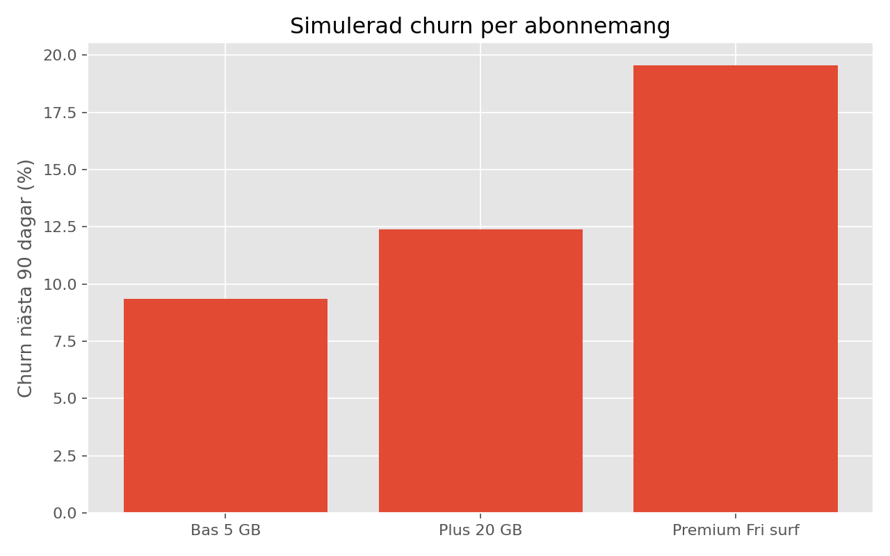
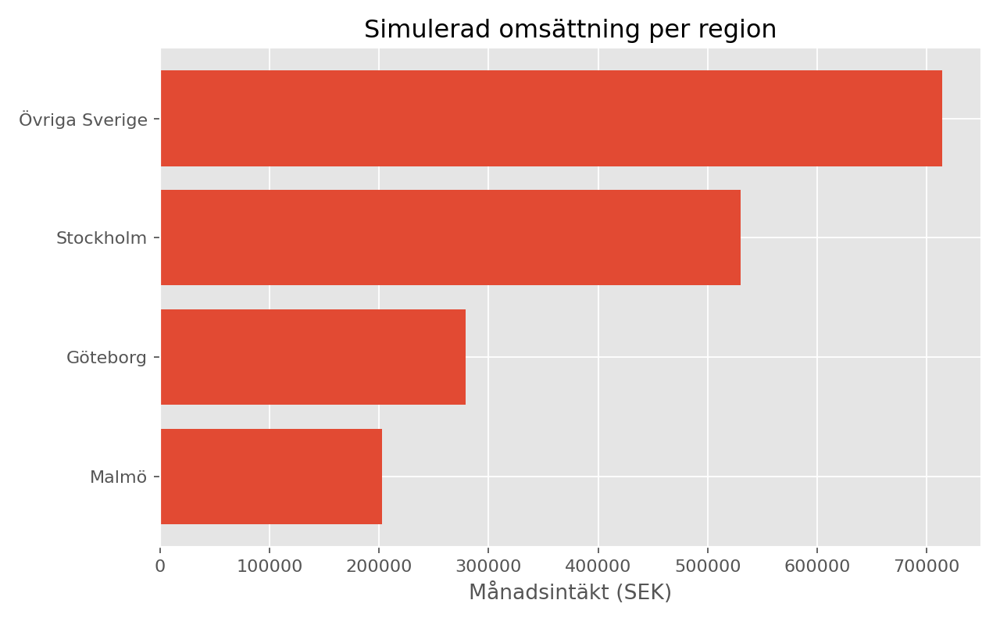
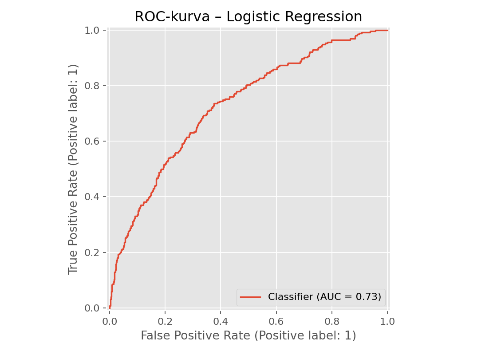

# Swedish Mobile Telecom — Subscription Analytics & Churn Prediction 🇸🇪

**An end-to-end Data Science portfolio project inspired by the Swedish subscription market (e.g., Telia, Tele2 and Comviq).** All customers, prices, revenue and outcomes in this repository are **synthetic** and must NOT be interpreted as real information about these companies. This is an independent educational project with no company affiliation.

## Business questions

1. How much monthly recurring revenue (MRR) do different subscription tiers generate?
2. What percentage of subscribers churns during the next 90 days?
3. Which plans and regions differ in churn and revenue?
4. Can we predict churn using customer tenure, support activity, satisfaction, contract type, pricing and usage?
5. How could a retention team prioritize customer outreach?

## Project overview

- **Dataset:** 8,000 reproducibly simulated Swedish mobile customers, including city region, monthly fee (SEK), data usage (GB), support contact, contract and churn.
- **Analysis:** KPI reporting, segment breakdown, churn plots and regional recurring revenue.
- **Machine learning:** Leakage-aware train/test separation (75/25), preprocessing in a `Pipeline`, 3-fold stratified CV, comparison of Logistic Regression vs Random Forest, evaluation on held-out test data.
- **Metrics:** ROC-AUC, average precision, precision, recall, F1, and confusion matrix.
- **Important:** A deliberately lower 0.25 classification threshold is used to make outreach more sensitive; it is a demonstration threshold, **not** one optimized on a production business-cost model.

## Reproduced results (synthetic data only)

| KPI | Result |
|---|---:|
| Customer records | 8,000 |
| 90-day churn | 12.72% |
| Monthly recurring revenue | 1,725,975 SEK |
| Annualized MRR (not a revenue forecast) | 20,711,700 SEK |
| Monthly fee per customer (ARPU proxy) | 215.75 SEK |
| MRR associated with customers who churn | 241,982 SEK |

This *revenue-at-risk proxy* is an observed synthetic churn cohort's monthly fees, not a causal forecast of lost revenue or realized retention savings.

Model test metrics are generated and saved under `reports/model_metrics.json` whenever you run the project. Compare CV metrics rather than using the held-out test set to pick a model.

## Visualizations





## Repository structure

```text
swedish-telecom-churn/
├── .github/workflows/tests.yml
├── data/synthetic_mobile_subscribers.csv
├── figures/
│   ├── churn_by_plan.png
│   ├── revenue_by_region.png
│   └── roc_curve.png
├── reports/
│   ├── kpis.json
│   ├── plan_segments.csv
│   └── model_metrics.json
├── src/__init__.py
├── src/analysis.py
├── tests/test_analysis.py
├── pytest.ini
└── requirements.txt
```

## Run locally

```bash
python -m venv .venv
# Windows: .venv\Scripts\activate
# macOS / Linux: source .venv/bin/activate
pip install -r requirements.txt
python src/analysis.py
python -m pytest -q
```

For a smaller sample: `python src/analysis.py --rows 3000`.

## Approach and limitations

This synthetic generator encodes churn drivers by assumption. Any correlations discovered by the model may simply reflect the simulator; the project therefore demonstrates a **repeatable analysis workflow**, not valid conclusions about Swedish subscribers. The dataset is a simulated cross-sectional snapshot, not real historical time-series observations. A real-world deployment would require lawful data access, chronological validation, calibration, subgroup fairness checks, monitoring, consent/legal review, experimentation and a business-cost model before churn-targeted offers.

## Potential next steps

- Replace synthetic data with a permitted, properly anonymized customer dataset.
- Build a Power BI dashboard for MRR, ARPU, churn and cohorts.
- Add time-series retention cohorts, calibration, business-value thresholds and explanation methods.

**Portfolio skills:** Python, pandas, EDA, data visualization, feature processing, scikit-learn, classification, stratified cross-validation, evaluation, automated tests.
